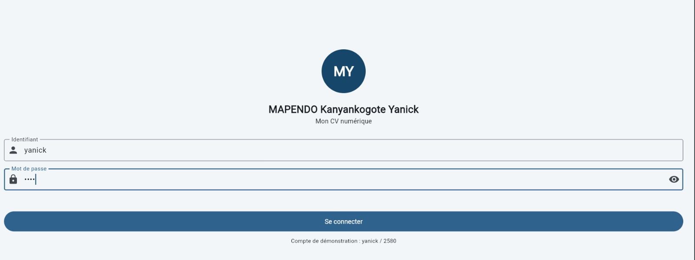
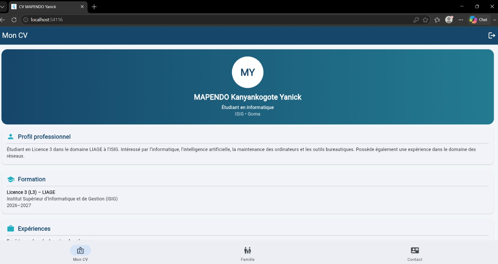
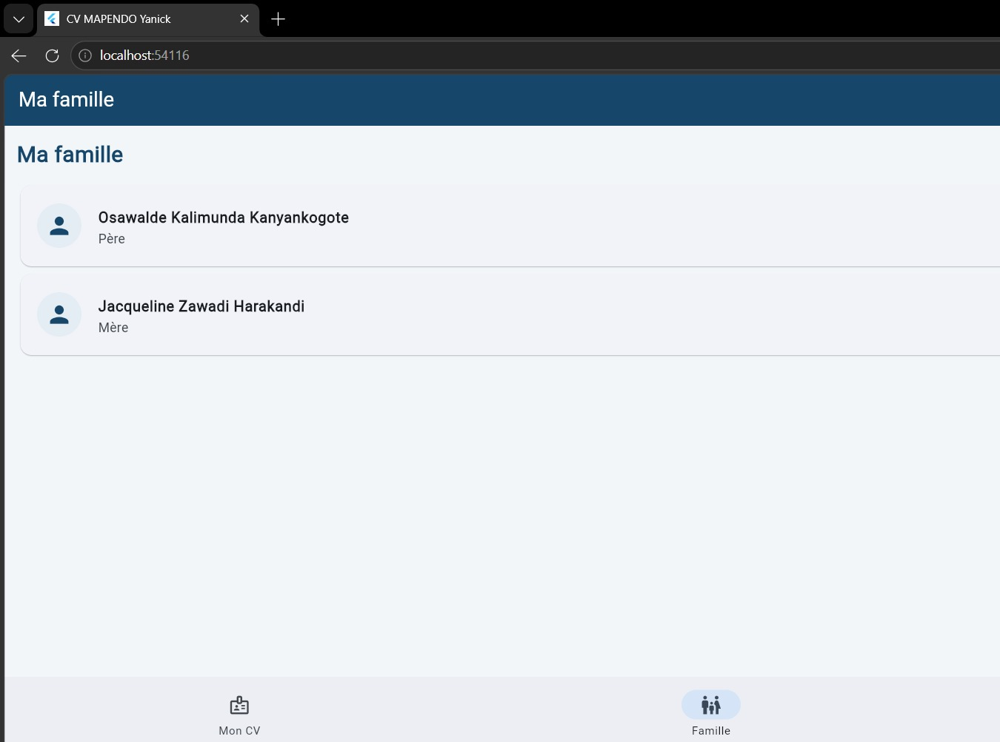
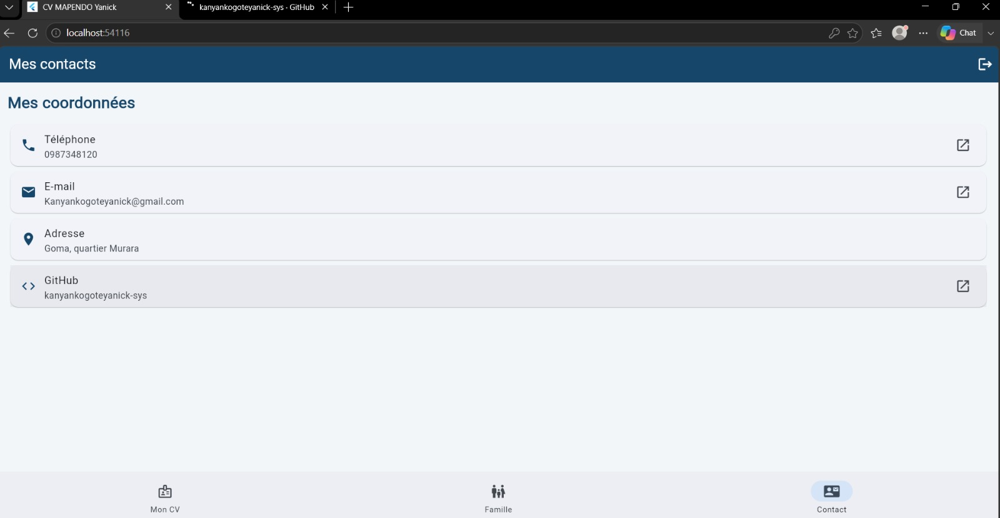

# CV Flutter — MAPENDO Kanyankogote Yanick

Application mobile réalisée avec Flutter et Dart dans le cadre d'un TP à l'ISIG Goma.

Elle présente quatre espaces : connexion, CV, famille et coordonnées.

## Fonctionnalités

- Connexion avec identifiant et mot de passe masqué.
- Présentation du profil, de la formation, des expériences et compétences.
- Présentation des membres de la famille.
- Coordonnées cliquables : téléphone, e-mail et GitHub.
- Navigation avec une barre inférieure.

## Identifiants de démonstration

- **Identifiant :** `yanick`
- **Mot de passe :** `2580`

> Ces identifiants sont prévus uniquement pour la démonstration du TP. Ils sont codés dans l'application et ne constituent pas une authentification sécurisée.

## Prérequis

- Flutter SDK installé et accessible dans le PATH.
- Visual Studio Code avec les extensions Flutter et Dart.
- Git installé.

## Installation et lancement

```bash
flutter pub get
flutter run
```

## Captures d'écran

Après avoir lancé l'application, réalise une capture de chacune des quatre pages et place les fichiers dans le dossier `screenshots/` avec exactement ces noms :

### 1. Connexion



### 2. Accueil — CV



### 3. Famille



### 4. Contact



## Structure du projet

```text
cv_flutter_yanick/
├── assets/
│   └── images/
│       ├── moi.jpg
│       ├── pere.jpg
│       └── mere.jpg
├── lib/
│   └── main.dart
├── screenshots/
│   ├── 01_connexion.png
│   ├── 02_accueil_cv.png
│   ├── 03_famille.png
│   └── 04_contact.png
├── pubspec.yaml
└── README.md
```

Ajoute les photos personnelles dans `assets/images/` :

- `moi.jpg` : photo de MAPENDO Kanyankogote Yanick.
- `pere.jpg` : photo de son père.
- `mere.jpg` : photo de sa mère.

Si les photos ne sont pas encore disponibles, l'application affiche des icônes ou des initiales de remplacement.

## Auteur

**MAPENDO Kanyankogote Yanick**

- **Institution :** ISIG Goma
- **Formation :** Licence 3 (L3) — LIAGE
- **Année académique :** 2026–2027
- **Adresse :** Goma, quartier Murara
- **Téléphone :** 0987348120
- **E-mail :** Kanyankogoteyanick@gmail.com
- **GitHub :** https://github.com/kanyankogoteyanick-sys

## Dépôt GitHub

[Consulter le dépôt du projet CV Flutter](https://github.com/kanyankogoteyanick-sys/MAPENDO-KANYANKOGOTE-YANICK)
